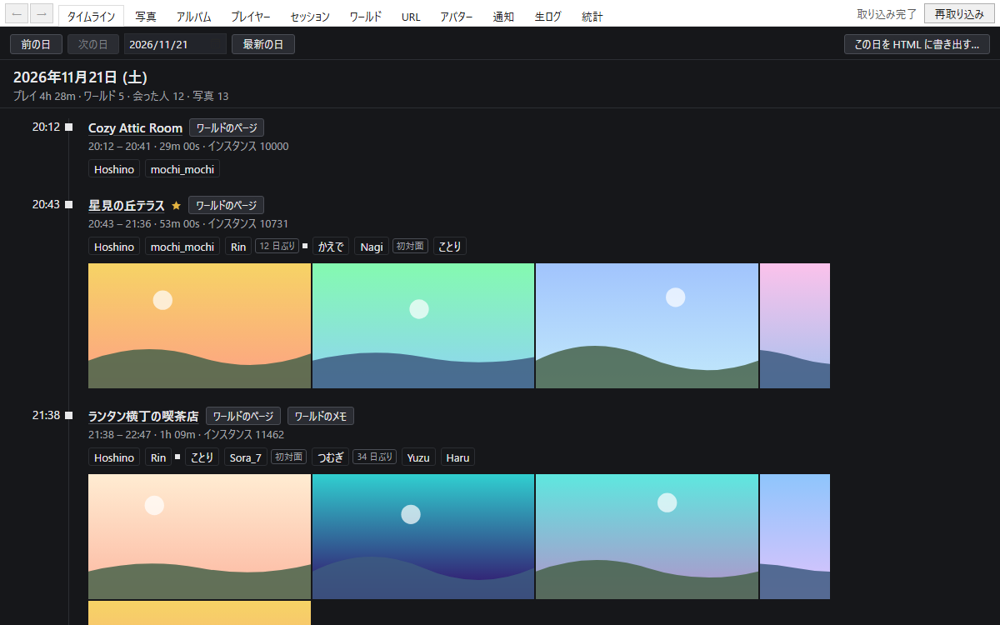
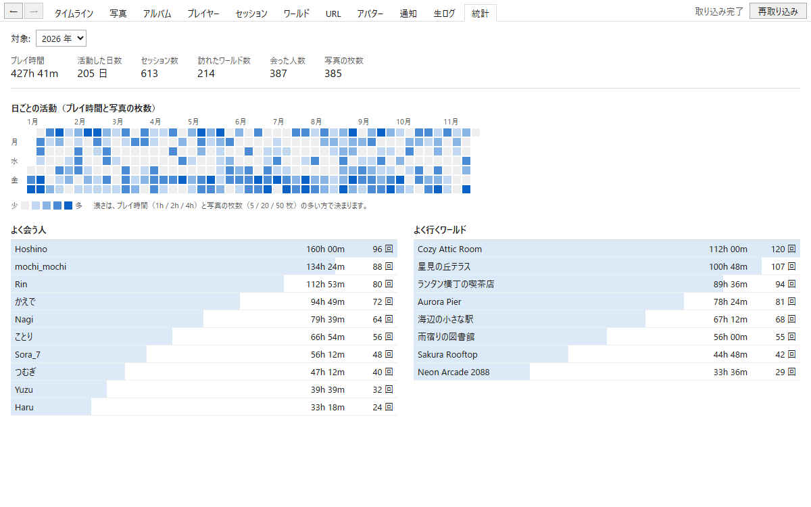

# Yorimichi for VRChat

VRChat で「いつ・どのワールドに行き・誰と会い・何を撮ったか」を振り返る、Windows 用のアプリです。
VRChat のログと写真フォルダを読み取り、1 日ごとのタイムラインにまとめます。

VRChat の非公式ツールです。VRChat Inc. とは関係ありません。

画像に写っている名前とデータは架空のものです。

## できること

- **タイムライン** — 1 日の流れを時刻順に表示します。行ったワールド、会った人、撮った写真が並びます。
- **写真** — 写真を日付ごとに並べ、撮った場所と一緒にいた人を表示します。お気に入りとアルバムを作れます。
- **プレイヤー** — 会った人を検索し、いつどこで会ったかを確認できます。メモとタグを付けられます。
- **ワールド** — 行ったワールドの回数と滞在時間を一覧にします。メモとお気に入りを付けられます。
- **統計** — 年ごとの活動量、よく会う人、よく行くワールドを表示します。
- **そのほかの記録** — 動画などの URL、アバター、招待やフレンド申請などの通知、ログの全文検索。
- **HTML への書き出し** — 1 日の記録やアルバムを、ブラウザで開ける 1 つのファイルにできます。

## 必要なもの

- Windows 10 / 11
- VRChat (PC 版) のログと写真

## インストール

1. [Releases](https://github.com/khlizard/yorimichi-vrc/releases) から `Yorimichi-win-Setup.exe` をダウンロードして実行します。
2. インストーラーに署名が無いため、Windows の警告が出ます。「詳細情報」→「実行」で進めます。

新しい版が出ると、アプリが自動でダウンロードし、再起動するかを尋ねます。

## 使い方

起動すると、VRChat のログと写真のフォルダを自動で探して読み込みます。設定は不要です。

- 写真が出ないときは、「ファイル → 設定…」の「写真」に、写真の保存先のフォルダを追加してください。
- ログは起動中、1 分ごとに取り込みます。初めて閉じるときに、タスクトレイに残して取り込みを続けるかを尋ねます。
- 記録できるのは、VRChat のログが残っている期間だけです。それより前は、写真だけが並びます。

### 操作

| 操作 | 方法 |
| --- | --- |
| 前の画面に戻る / 進む | タブの左の「←」「→」、Alt+← / Alt+→、マウスの戻る・進むボタン |
| 写真の操作 | 右クリック (詳細情報、コピー、フォルダで表示、アルバムに追加など) |
| タイムラインの前の日 / 次の日 | `[` / `]` キー |
| 期間で絞り込む | 「表示 → 期間で絞り込む…」。絞り込み中はタブの右に期間が出て、「×」で解除できます |

## データの扱い

- **記録はこの PC の中だけに保存します。** 外部への送信はしません。通信するのは、更新の確認と、あなたが VRChat のページを開く操作をしたときだけです。
- **写真は変更しません。** 移動、削除、再圧縮はしません。例外は、あなたが「メタデータの書き込み」を実行したときだけです ([docs/metadata.md](docs/metadata.md))。
- **同期アプリのオンライン専用ファイルは、勝手にダウンロードしません** (Dropbox、OneDrive など)。
- 設定とデータベースは `%APPDATA%\Yorimichi` にあります。データベースは定期的にバックアップします。
- データベースを同期アプリのフォルダに置く場合、2 台以上の PC から同時に開かないでください。壊れる恐れがあります。別の PC で見るには、「ファイル → 閲覧用 HTML を書き出す…」を使ってください。

## 設定

「ファイル → 設定…」で変更できます。よく使うものは次のとおりです。

| 項目 | 内容 |
| --- | --- |
| 写真 | 写真を探すフォルダ。下の階層まで探します |
| 1 日の区切り | この時刻までは前日として扱います (既定は 6 時) |
| テーマ | Windows に合わせる / ライト / ダーク |
| 常駐と起動 | 閉じても取り込みを続けるか、Windows の起動時に始めるか |

すべての項目は [docs/settings.md](docs/settings.md) にあります。

## 詳しい説明

- [docs/settings.md](docs/settings.md) — 設定の全項目と、写真の読み込みの仕組み
- [docs/metadata.md](docs/metadata.md) — 写真のメタデータの読み書き
- [docs/development.md](docs/development.md) — ビルドと開発の手順

## ライセンス

[MIT License](LICENSE)

インストーラーには、含まれるライブラリのライセンスの一覧 (`THIRD-PARTY-LICENSES.html`) が入っています。
